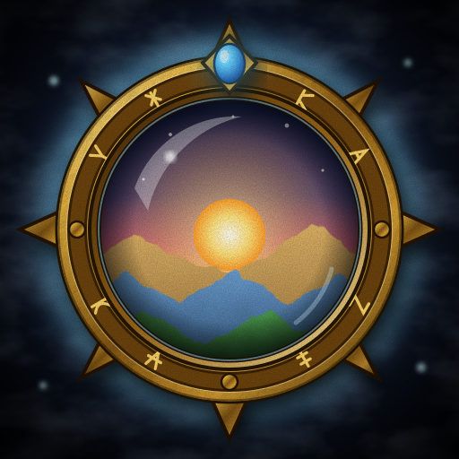

# Sightline



Adaptive view distance for _World of Warcraft: Forever_. Sightline keeps your view distance
long where you can see far and shortens it where buildings, walls or water are in the way, so
a high setting costs frames only where it gives you something to look at. It also calibrates
every place you visit so your frame rate stays at or above a goal.

It is not occlusion culling. An addon cannot change what the game draws; Sightline changes
the view-distance settings the game already has, using what the game reports about where you
are: indoors, in a city, in an instance, resting, underwater. Your own settings are the
ceiling, and they are put back when you log out.

## Features

- **Your settings are the 100%.** Whatever you set in the graphics menu or the console is the
  full value. Sightline only scales down from it, picks up a change you make while it is
  scaled, and restores your values on logout and `/reload`.
- **Three bands, scaled by different amounts.** _Far_ settings (terrain, horizon) are the
  first thing a wall hides, so they drop the most. _Mid_ settings (building and terrain
  detail) drop about half as much. _Near_ settings (ground clutter, characters) barely move.
  Every setting can be switched off or moved to another band, and any other numeric setting
  can be added by name.
- **A calibration for every place.** The first time you enter a subzone, Sightline lowers the
  distances a step at a time until you hold at least 60 FPS, and saves the result. If FPS
  drops there later it recalibrates from the saved value. A step that makes no noticeable
  difference is reverted, and where lowering stops helping, view distance is given back.
- **An optional target FPS.** Aim for a frame rate instead of a minimum. With spare frames,
  distances can also be raised, past your own settings if you allow it.
- **Knows when you have alt-tabbed.** An addon cannot see whether the game is in the
  background. A low reading is measured again before anything changes: FPS holding at your
  background FPS cap means the game is in the background, and anything else is measured once
  more with that cap switched off for a moment.
- **Engine maximum.** One button raises every view-distance setting to the highest the
  graphics menu goes, so Sightline has the most to work with. It can be undone.
- **A window for everything.** Live values for the place you are in, every setting, the list
  of calibrations (each can be set by hand, locked, redone or deleted) and a log of recent
  tests.
- **Teach it a spot.** The game does not say when you are in a narrow canyon or a dense
  forest. Stand there, set how open it is, and save it for the subzone or the whole zone.

## Installing

Releases go to CurseForge and to this repository's
[Releases](https://github.com/TheWeion/Sightline/releases) page. To install by hand, download
the zip from the latest release and unzip it into your Forever client's `Interface/AddOns`
folder, so that `Sightline.toc` is at `Interface/AddOns/Sightline/Sightline.toc`. Restart the
game.

The first time you log in, Sightline asks whether to start from the engine maximum or from
the view distances you have now.

## Using it

`/sight` (or `/sightline`) or the minimap button opens the window. Right-clicking the minimap
button pauses Sightline and puts your settings back.

| Tab          | What it is for                                                              |
| ------------ | --------------------------------------------------------------------------- |
| Overview     | Where you are, how each band is scaled, and every setting's current value   |
| Distances    | Which settings are managed, and the band each one follows                   |
| Environments | How much each band keeps in each kind of place                              |
| Zones        | How open a spot is, saved for a subzone or a zone                           |
| Calibrations | Every calibrated place: set by hand, lock, recalibrate or delete            |
| Performance  | The FPS goal, how tests are judged, live FPS and recent tests               |
| Settings     | Scaling speed, the minimap button, and your values against the engine's max |

| Command                         | Does                                              |
| ------------------------------- | ------------------------------------------------- |
| `/sight`                        | Opens or closes the window                        |
| `/sight on`, `/sight off`       | Resumes, or pauses and restores your settings     |
| `/sight fps 75`, `/sight fps off` | Sets a target FPS (15 to 360), or turns it off  |
| `/sight here 60`, `/sight here clear` | Saves or clears this subzone's openness (0 to 100) |
| `/sight zone 60`, `/sight zone clear` | The same for the whole zone                 |
| `/sight minimap`                | Shows or hides the minimap button                 |
| `/sight debug`                  | Prints each change and test to chat               |

## How it works

**Openness.** Twice a second Sightline works out what kind of place you are in and scales
each band from the table below. Capital cities and saved spots use one openness value
instead: Far takes the whole drop, Mid half of it and Near 15%.

| Where            | Far  | Mid  | Near |
| ---------------- | ---- | ---- | ---- |
| Open world       | 100% | 100% | 100% |
| Flying           | 100% | 100% | 70%  |
| Battlegrounds    | 90%  | 100% | 100% |
| Towns and inns   | 70%  | 85%  | 100% |
| Dungeons, raids  | 55%  | 80%  | 100% |
| Underwater       | 35%  | 50%  | 80%  |
| Indoors, caves   | 30%  | 60%  | 95%  |

The settings it manages are `farclip`, `horizonStart` and `horizonClip` (Far),
`terrainLodDist` and `wmoLodDist` (Mid), and `entityLodDist` and `groundEffectDist` (Near).
Only the first and last have a control in the graphics menu; the game uses the others all the
same. Any that the client does not have are skipped. Values move towards their target over a
second or two, and small changes are skipped, because every change makes the game load or
unload terrain.

**Calibration.** On top of that, each place (zone, subzone and kind of place) has an
adjustment between 50% and 100%. FPS is averaged over four seconds, after the terrain has
finished loading. Below the goal, a step of 10% lower is tested and kept only if FPS rises by
at least 5% and 2 FPS; otherwise it is reverted and not tried again for 90 seconds. A drop is
measured twice before anything is lowered, and tests stop in combat.

**The engine maximum.** The addon API cannot report a setting's maximum. Sightline sets the
graphics menu's View Distance, Environment Detail and Ground Clutter to their top level for a
second, reads the values the game picks, and puts the menu back.

## Limits

- It estimates. It cannot see the wall in front of you, only that you are in a city. Saved
  spots are how you correct it.
- Lowering view distance helps when the graphics card is the limit. In a crowded city the
  processor usually is, and Sightline will report that lowering did not help.
- If your real frame rate sits exactly at your background FPS cap, Sightline takes the game
  to be in the background and leaves that place alone.
- Detecting the engine maximum goes through the graphics menu's presets, which can reset
  console-only settings Sightline does not manage to the preset's values.
- Capital cities are recognised by Classic's map IDs and their English names.

## Development

`Core.lua` holds the scaling and calibration, `GUI.lua` the window, minimap button and
welcome dialog, and `Media/Icon.svg` is the source of the icon (`Media/Icon.tga`, 128px).

`tests/sim.lua` plays through the addon against a stand-in for the game's API: scaling,
calibration, alt-tabbing, the engine maximum and every control in the window. It needs
nothing but Lua 5.1, the version the game runs, and CI runs it on every push:

```sh
lua5.1 tests/sim.lua
```

Commit messages follow [Conventional Commits](https://www.conventionalcommits.org).

### Releasing

The version is in `Sightline.toc` and `Core.lua`. To cut a release:

1. Set the new version in both, and commit it as `chore(release): 1.0.1`.
2. Tag that commit and push the tag: `git tag v1.0.1 && git push origin v1.0.1`.
3. `release.yml` checks the tag against the version, runs the tests, packages the addon
   (`.pkgmeta` says what stays out of the zip) and publishes a GitHub Release with the zip
   and the commits since the last tag. A tag with `alpha` or `beta` in it makes a
   pre-release.
4. CurseForge packages the same tag itself, told of the push by the repository's webhook,
   and reads the same `.pkgmeta`.

Running the workflow by hand (**Actions**, **release**, **Run workflow**) packages without
publishing: the zip is attached to the run.

## Licence

Copyright (C) 2026 TheWeion. Sightline is free software: you can redistribute it and modify
it under the terms of the [GNU General Public License, version 3](LICENCE). It comes with no
warranty.
